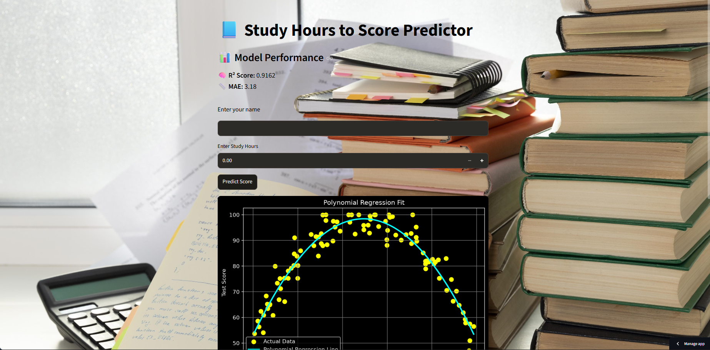

# Study Hours to Score Predictor

[](https://study-predictor.streamlit.app/) [](https://xyrusportfolio.netlify.app/)

> An educational Streamlit demonstration of degree-two polynomial regression, using study hours to estimate a corresponding test score.

**Live demo:** https://study-predictor.streamlit.app/  
**Project documentation and source:** https://github.com/ebukaxyrus/study-score-predictor  
**Maintainer:** Dimakunne Chukwuebuka Francis

## At a glance

| Area | Details |
| --- | --- |
| Category | Machine Learning / Education |
| Application framework | Streamlit |
| Entry point | `Study_app.py` |
| Deployment | [Open live application](https://study-predictor.streamlit.app/) |

## Application preview

[**Launch the live interactive application**](https://study-predictor.streamlit.app/) to view its actual interface.



## The problem and approach

An educational Streamlit demonstration of degree-two polynomial regression, using study hours to estimate a corresponding test score.

The script transforms `study_hours` through `PolynomialFeatures(degree=2)` and fits `LinearRegression`. Reported R² and MAE are calculated against **the same data used to train the model**. These are in-sample statistics, not held-out model evaluation. A separate train/test split or cross-validation is needed to estimate generalization.

## Features

- Read the `student_test_scores.csv` dataset.
- Generate degree-two polynomial features and fit a linear-regression estimator.
- Show model-fit R² and mean absolute error (MAE).
- Take the learner's name and a study-hour input.
- Display an estimated score and contextual study-hour messages.
- Visualize data points and the fitted regression curve.
- Download a generated chart as PNG.
- Store prediction entries in a local CSV file in the current implementation.

## Technology stack

- Python
- Streamlit
- Pandas
- NumPy
- scikit-learn
- Matplotlib

## Repository structure

- `Study_app.py` — Streamlit UI, model fitting, charting, predictions and local CSV logging.
- `student_test_scores.csv` — source dataset.
- `requirements.txt` — Python dependencies.

## Run locally

Prerequisites: Python 3.10+ is a reasonable starting environment, but no fixed compatibility matrix has been independently tested. Check the dependency versions actually available for your environment.

```bash
git clone https://github.com/ebukaxyrus/study-score-predictor.git
cd study-score-predictor
python -m venv .venv
```

Activate the environment:

```bash
# macOS or Linux
source .venv/bin/activate
# Windows PowerShell
# .venv\\Scripts\\Activate.ps1
```

Install packages and start the app:

```bash
python -m pip install -r requirements.txt
streamlit run Study_app.py
```

Run from the repository root so the app can find its local data/assets. Where the app uses text-to-speech or browser capabilities, allow the relevant permissions.

## How to use

1. Launch the app and inspect its model-fit information.
2. Enter your name and study hours.
3. Click **Predict Score**.
4. Review the estimate, chart and explanatory message.
5. Download the chart if desired.

## Limitations and responsible use

- Predictions do not establish that increasing study hours causally improves scores.
- Extrapolation outside the observed training range may produce unrealistic results.
- Model fit should be independently validated before making accuracy claims.
- The current implementation records learner names and predictions in a local CSV; review consent, privacy, persistence and concurrent-use behavior.
- Review the blank-name prediction path and CSV logging behavior as part of future testing.

## Quality and future improvements

- [ ] Test a clean installation and pin compatible dependency versions.
- [ ] Add real screenshots, alt text and demonstration media.
- [ ] Add automated tests for primary use cases and invalid input.
- [ ] Review accessibility, error handling and mobile usability.
- [ ] Verify datasets, licenses, user privacy, and live deployment behavior.

## Maintainer and links

**Dimakunne Chukwuebuka Francis**  
Head of Data & Artificial Intelligence, Schoolville ICT Hub  
Founder, XY AI Solution

- [Professional portfolio](https://xyrusportfolio.netlify.app/)
- [GitHub profile](https://github.com/ebukaxyrus)
- [XY AI Solution](https://xyaisolution.online/)

**Documentation scope:** Written from repository source inspection; successful clean-environment installation and end-to-end live application behavior have not been independently verified.
